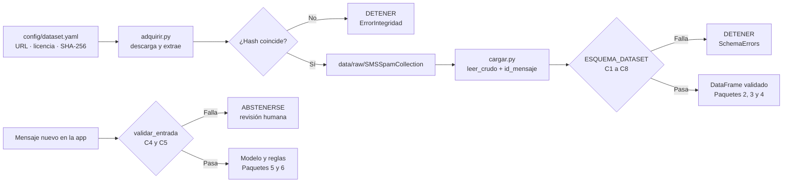

# Guía de la infraestructura de datos · Paquete 1

> Para presentar al equipo y preparar la defensa individual. Autor: Melvin.

---

## 1. La idea en una frase

> **"Todos cargamos los mismos datos, verificados y validados, con una sola línea: `cargar_datos()`. Si algo no cuadra, el sistema se detiene antes de que alguien entrene un modelo con datos equivocados."**

## 2. El recorrido completo



Si el diagrama no se ve, este es el mismo flujo en texto:

```
dataset.yaml → adquirir.py → ¿hash OK? → cargar_datos() → ¿contrato OK? → equipo
                                 ↓ no                          ↓ no
                              DETENER                       DETENER

mensaje nuevo → validar_entrada() → ¿OK? → modelo
                                     ↓ no
                               ABSTENERSE → humano
```

## 3. Cada archivo, explicado

### `config/dataset.yaml`: la fuente única de verdad
- **Qué es:** un archivo de texto con todo lo que sabemos del dataset: URL, versión, licencia, cita y **hash**.
- **Por qué YAML:** se lee como texto normal y Python lo convierte en un diccionario con `yaml.safe_load`.
- **Frase para explicarlo:** *"Si mañana cambia la fuente, se cambia en un solo lugar, con un PR, y queda registrado."*

### `src/data/adquirir.py`: obtener los datos siempre igual
- `calcular_sha256(ruta)` lee el archivo en bloques y produce su **huella digital** de 64 caracteres. Basta con que cambie un carácter del archivo para que la huella sea totalmente distinta.
- `extraer()` saca del ZIP **solo** los dos archivos esperados. No usa `extractall()` por seguridad.
- `verificar_integridad()` compara el hash calculado con el del YAML. Si no coinciden, lanza `ErrorIntegridad`.
- `main()` devuelve `1` si hay error. Así un pipeline de CI sabe que falló.
- **Concepto clave: reproducibilidad.** Cualquier persona, en cualquier computadora, obtiene exactamente el mismo archivo o recibe un error.

### `src/data/esquema.py`: el contrato
- Usa **pandera**, una librería que describe cómo debe ser un DataFrame y lo valida.
- `pa.Column(str, checks=..., nullable=False)` declara el tipo, las reglas y si se permiten nulos.
- `strict=True` rechaza columnas no declaradas. `ordered=True` exige el orden.
- `checks=[...]` a nivel de DataFrame contiene reglas que miran **toda la tabla** (C6, C7, C8).
- `raise_warning=True` convierte una regla en **advertencia** en lugar de error (C8).
- **Dos contratos:** uno para el dataset (con etiqueta) y otro para la app (solo texto, porque un mensaje nuevo todavía no tiene etiqueta).

### `src/data/cargar.py`: la puerta de entrada
- `leer_crudo()` lee el TSV. Tres detalles que debes saber explicar:
  - `quoting=csv.QUOTE_NONE`: los SMS tienen comillas. Sin esto, pandas uniría líneas y perderíamos mensajes.
  - `keep_default_na=False`: un SMS que dice "NA" es texto, no un valor faltante.
  - `id_mensaje`: número de línea original, para la **trazabilidad** que exige el curso.
- `cargar_datos()` ejecuta integridad, lectura y contrato, en ese orden. `lazy=True` reporta **todos** los errores juntos.
- `validar_entrada(texto)` devuelve `(True, "ok")` o `(False, motivo)`. Si es `False`, la app **se abstiene**.

### `tests/test_contrato.py`: la prueba de que el contrato funciona
- **Familia A (datos reales):** el archivo es v.1 y cumple el contrato con 5 574 / 4 827 / 747.
- **Familia B (datos alterados):** cada regla tiene una prueba que la **rompe a propósito** y comprueba que se rechaza.
- `@pytest.fixture df_valido`: 20 mensajes inventados y válidos que cada prueba altera.
- `@pytest.mark.parametrize`: la misma prueba con varios valores ("Spam", "phishing", "").
- `skipif`: si alguien no ha descargado los datos, esas pruebas se omiten con un mensaje en lugar de fallar sin explicación.
- **Resultado actual:** 13 funciones de prueba que suman 22 casos, todos aprobados.

### `scripts/demo_gobernanza.py`: tu demostración
Los 4 pasos de la sección 5, en un solo comando.

## 4. Guion para presentar al equipo (10–12 minutos)

| Min. | Qué dices | Qué muestras |
|---|---|---|
| 0–1 | "Mi paquete garantiza que todos trabajamos con los mismos datos, legales y validados." | Diagrama de la sección 2 |
| 1–3 | Dataset: 5 574 SMS, 13.4 % spam, CC BY 4.0, inglés de UK y Singapur, 2003–2011 | `ficha_dataset.md` |
| 3–5 | Las 3 alertas: **403 duplicados**, **sesgo de fuente**, **no vale para español** | `diccionario_datos.md` (alertas) |
| 5–8 | Demo en vivo | `python -m scripts.demo_gobernanza` |
| 8–9 | Cómo lo usan: `cargar_datos()` y `validar_entrada()` | `README.md` |
| 9–10 | Reglas del equipo: no leer el CSV directo, no subir datos, cambios al contrato por PR | `contrato_datos.md` |
| 10–12 | Preguntas | — |

**Mensajes puntuales para cada compañero:**
- **Berroa (P2):** "Tienes 403 duplicados. Deduplica o agrupa **antes** de partir, o habrá fuga."
- **Jhonathan (P3):** "Usa `cargar_datos()`. `id_mensaje` no es una característica. spam = 1."
- **Daniel (P4):** "Accuracy engaña con 13.4 % de spam. Revisa errores por longitud y fuente."
- **Johanna (P5):** "`validar_entrada()` es tu primera regla de abstención. Las condiciones de detener o escalar están en `riesgos_y_usos.md`."
- **Roque (P6):** "Llama a `validar_entrada()` antes del modelo. Muestra en la interfaz que el sistema solo sirve para SMS en inglés."
- **Rossesleidy (P7):** "Mis 22 casos pueden ir en el CI: `python -m src.data.adquirir && pytest`. La Model Card puede citar la ficha."

## 5. Demostración en vivo (para la presentación y la defensa)

```bash
python -m src.data.adquirir --verificar   # 1. integridad
python -m scripts.demo_gobernanza         # 2. contrato + alteraciones + abstención
pytest -v                                 # 3. las pruebas
```

**Truco para la defensa:** abre `data/raw/SMSSpamCollection`, cambia una letra, guarda y ejecuta `python -m src.data.adquirir --verificar`. Verás `ERROR DE INTEGRIDAD`. Después restaura el archivo con `python -m src.data.adquirir --zip ...`.

## 6. Preguntas probables y respuestas

**¿Por qué no subir el dataset a Git?**
Ya es público y versionado en UCI. Versionamos *cómo obtenerlo* y *su hash*, que es más liviano y equivale a la misma garantía. Además, contiene nombres y teléfonos.

**¿Qué es un hash y por qué SHA-256?**
Es una huella digital del archivo. Si cambia un carácter, la huella cambia por completo. SHA-256 es un estándar sin colisiones prácticas conocidas.

**¿Por qué los duplicados son advertencia y no error?**
Son reales en la fuente; rechazarlos impediría usar el dataset oficial. Pero son un riesgo de fuga, y su tratamiento es decisión del Paquete 2. El contrato **avisa** y el Paquete 2 **resuelve**.

**¿Por qué el rango 5 %–30 % de spam?**
v.1 tiene 13.4 %. Un archivo fuera de ese rango casi seguro es otro dataset, uno filtrado o uno corrupto. Es un control de cordura con margen amplio.

**¿Qué diferencia hay entre el contrato del dataset y el de entrada?**
El dataset tiene etiqueta y se evalúa como tabla completa (proporciones, contradicciones). Un mensaje nuevo solo tiene texto y se valida uno por uno.

**¿Qué pasa si UCI publica otra versión?**
El hash no coincidirá y `adquirir` se detendrá. Se revisa el cambio, se actualiza el YAML mediante PR, se anota en `registro_cambios.md` y se vuelven a correr las pruebas.

**¿Por qué pandera y no solo `assert`?**
Es declarativo: el contrato se lee como una tabla de reglas y reporta todas las violaciones con su causa. Con `assert` sueltos se detiene en la primera y el código es más difícil de mantener.

**⭐ Pregunta de defensa del curso: ¿qué evidencia justifica priorizar revisión o cuarentena con apelación, y qué obligaría a detener, abstenerse o escalar?**
Desde gobernanza:
- **Evidencia:** datos de procedencia y licencia verificadas, versión garantizada por hash, contrato aprobado y limitaciones documentadas. La cuarentena es **reversible** porque un falso positivo (bloquear un mensaje legítimo) tiene un costo alto para el usuario.
- **Evidencia de rendimiento (Paquete 4):** en prueba, el modelo elegido no bloqueó ningún mensaje legítimo (precisión de spam de 100 %, 0 de 678) y detectó el 91.4 % del spam. El estudio del umbral del Paquete 5 muestra que bajar el umbral empieza a bloquear mensajes legítimos.
- **Detener:** el hash o el contrato fallan.
- **Abstenerse:** la entrada viola el contrato, el idioma está fuera de cobertura o la probabilidad cae en la zona gris.
- **Escalar:** el usuario apela, o la precisión de spam en el monitoreo cae por debajo del umbral.

**¿Este modelo serviría para SMS en República Dominicana?**
No sin datos nuevos. El dataset es inglés de Reino Unido y Singapur, de 2003–2011. Usarlo aquí es un **uso no permitido** documentado.

**¿Qué parte hizo la IA?**
Lo declaras en `docs/declaracion_ia.md`. Lo que cuenta es que puedas explicar y ejecutar cada línea, y para eso está esta guía.

## 7. Plan de issues y commits (tu evidencia Git)

En GitHub, **issues y pull requests comparten numeración** (el PR #2 ocupó el número 2). Por eso: crea el issue primero, mira el número que recibe y úsalo en el commit.

| Issue | Rama | Archivos | Commit |
|---|---|---|---|
| #1 Estructura base | `feat/p1-estructura` (PR #2) | `.gitignore`, `README.md`, `requirements.txt`, `pyproject.toml`, `.github/`, `data/README.md`, `data/raw/.gitkeep` | `chore: agrega dependencias, config de pytest y plantillas de issue/PR (#1)` |
| #3 Ficha y configuración | `feat/p1-ficha` | `config/dataset.yaml`, `docs/gobernanza/ficha_dataset.md` | `docs(datos): agrega ficha del dataset y configuración de la fuente (#3)` |
| #4 Adquisición | `feat/p1-adquisicion` | `src/__init__.py`, `src/data/__init__.py`, `src/data/adquirir.py` | `feat(datos): adquisición reproducible con verificación SHA-256 (#4)` |
| #5 Diccionario | `feat/p1-diccionario` | `docs/gobernanza/diccionario_datos.md` | `docs(datos): diccionario de datos y alertas para otros paquetes (#5)` |
| #6 Contrato y carga | `feat/p1-contrato` | `src/data/esquema.py`, `src/data/cargar.py`, `docs/gobernanza/contrato_datos.md` | `feat(datos): contrato de datos C1-C8 y función cargar_datos (#6)` |
| #7 Pruebas | `feat/p1-pruebas` | `tests/test_contrato.py`, `scripts/__init__.py`, `scripts/demo_gobernanza.py` | `test(datos): pruebas del contrato y demo de gobernanza (#7)` |
| #8 Riesgos y registro | `feat/p1-riesgos` | `docs/gobernanza/riesgos_y_usos.md`, `docs/gobernanza/registro_cambios.md`, `docs/gobernanza/guia_infraestructura.md`, `docs/declaracion_ia.md` | `docs(gobernanza): decisor, usos, riesgos y registro de cambios (#8)` |
| #9 Ajustes del repositorio | `feat/p1-ajustes-repo` (después de integrar el PR #2) | `.gitattributes`, `README.md`, `requirements.txt` | `chore: normaliza finales de línea y documenta protección de main (#9)` |

Cada PR lo revisa otro compañero. **Tú revisas al menos un PR de otro paquete** (lo natural es el de Berroa, P2, porque consume tus datos).

## 8. Validaciones pendientes con el equipo y el docente

- [x] Modalidad confirmada: **A · Proyecto aplicado** (no DSS). El Paquete 5 estudia el umbral, la abstención y el costo de bloquear legítimos.
- [ ] Acordar cuántas de las **12 pruebas** del equipo son de contrato (aquí hay 13 funciones).
- [ ] Validar en equipo los usos no permitidos y las condiciones para detener o escalar.
- [ ] Confirmar con el docente que la documentación en Markdown dentro del repositorio es válida.
